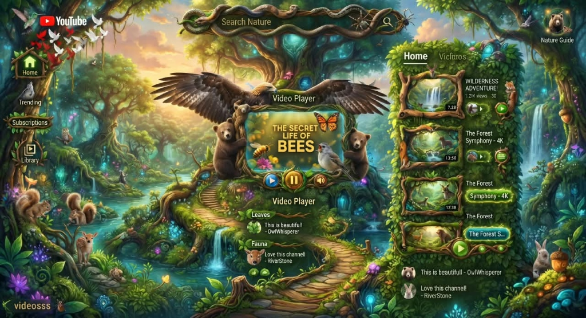
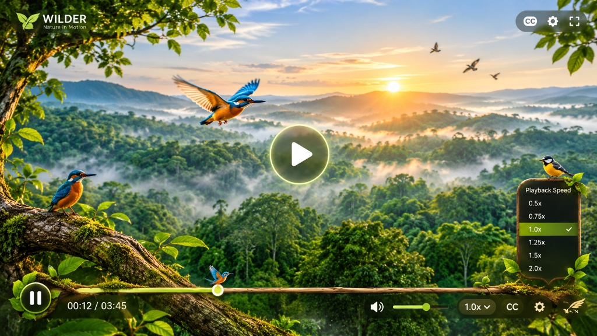
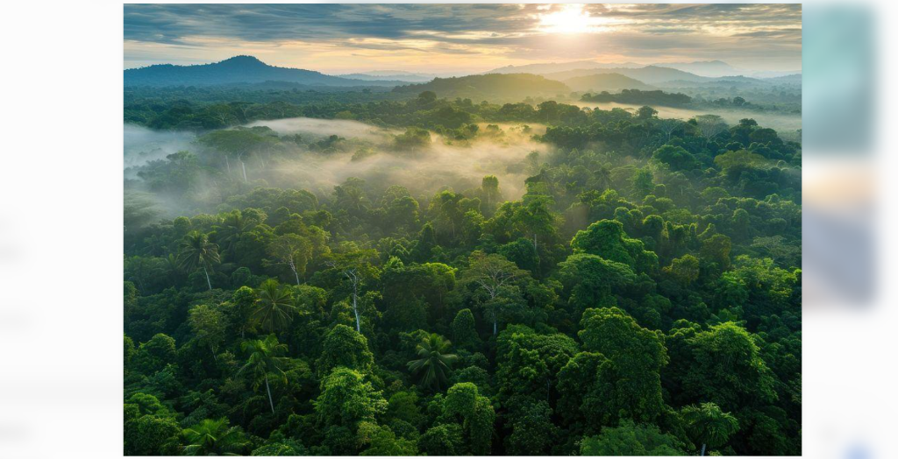

# WILDER — Nature in Motion
### Official Video.js v10 Living World Skin Design Showcase

[](https://videojs.com/)
[](https://react.dev/)
[](https://www.typescriptlang.org/)
[](https://vitejs.dev/)
[](LICENSE)

---

## 📸 Visual Showcase

<div align="center">
  
</div>

<p align="center">
  <em>The WILDER Living Sanctuary interface: ancient tree shrine player, hand-crafted avian controls, natural branch timeline, and lush rainforest atmosphere.</em>
</p>

<br />

<div align="center">
  <table width="100%">
    <tr>
      <td width="50%" align="center">
        
        <br />
        <strong>Avian Controls & Organic Scrubber</strong>
      </td>
      <td width="50%" align="center">
        
        <br />
        <strong>Atmospheric Rainforest Canvas</strong>
      </td>
    </tr>
  </table>
</div>

---

## 🌿 Vision & Concept

**WILDER** is an award-winning, nature-inspired video player skin engineered specifically for **Video.js v10**. Designed for high-end wildlife cinematography, natural history documentaries, and interactive conservation showcases, WILDER transforms the standard media player into a living fantasy forest sanctuary.

Every button, slider, and progress indicator is directly inspired by living nature:
- **Crown Golden Eagle**: Majestic outstretched eagle wings spanning across the top of the video player.
- **Flanking Bear Cubs**: Adorable brown bear cubs clinging to the ancient oak tree pillars.
- **Fauna Accents**: Animated monarch butterfly with 3D wing fluttering and a singing robin perched on the twig.
- **Tactile Circular Glowing Controls**: Luminescent sapphire rewind, golden amber solar play/pause, and topaz acoustic volume.
- **Natural Branch Timeline**: Gnarled wooden bark scrubber with glowing nectar progress line, chapter dew drops, and an aerodynamic hummingbird seek glider.
- **Serpentine Twisted Branch Search**: Natural input field for searching the documentary catalog.
- **Lush Ivy Hedge Sidebar**: Curated recommended nature documentaries with real-time video switching.
- **Sanctuary Path Voices**: Real-time viewer commentary stream where nature enthusiasts can post live observations.

---

## 🛠️ Architecture & Video.js v10 Integration

WILDER is built on top of official `@videojs/react` v10.3.0 and `@videojs/mux-video` primitives, providing hardware-accelerated HTML5 video rendering and seamless HLS/MP4 playback.

```
src/
├── components/
│   ├── fantasy/
│   │   ├── FantasyAvianDecor.tsx     # Handcrafted SVG eagle, bear cubs, butterfly, robin, search frame
│   │   ├── FantasyCenterPlayer.tsx   # Ancient tree shrine player, glowing controls, branch timeline
│   │   ├── FantasyLeftNav.tsx        # Carved wooden tree trunk navigation (Home, Trending, Subscriptions, Library)
│   │   ├── FantasyRightSidebar.tsx   # Ivy-covered recommended documentaries panel with live comments
│   │   └── FantasyTopNav.tsx         # WILDER brand identity, twisted branch search, Nature Guide profile
│   └── wilder/
│       ├── BirdIcons.tsx             # Avian silhouettes and seek glider
│       ├── WilderSettingsModal.tsx   # Stream quality, audio acoustics, and narration preferences
│       └── WilderSkin.tsx            # Master Video.js v10 state orchestrator & lifecycle hooks
├── config/
│   └── media.ts                     # Documentary catalog, chapters, audio specs, and video sources
├── pages/
│   └── LandingPage.tsx              # Single-screen 100vh sanctuary composition
└── styles/
    ├── fantasy-forest.css           # Atmospheric lighting, volumetric god rays, living particle animations
    └── wilder-tokens.css            # Earth, charcoal, gold, and foliage design tokens
```

---

## ⌨️ Accessibility & Keyboard Hotkeys

WILDER complies with **WCAG 2.1 AA** accessibility standards:
- High contrast typography and control indicators over both dark and bright nature footage.
- Visible focus rings (`:focus-visible`) with illuminated emerald halos.
- Full ARIA semantics: `role="slider"`, `aria-valuemin`, `aria-valuemax`, `aria-valuenow`, `aria-valuetext`, and descriptive `aria-label`s on all controls.
- Reduced motion support: `@media (prefers-reduced-motion: reduce)` smoothly disables particle drifts and wing animations.

### Keyboard Shortcuts:
| Key | Action |
| :--- | :--- |
| `Space` / `K` | Toggle Play / Pause |
| `Left Arrow` | Rewind 5 seconds |
| `Right Arrow` | Skip forward 5 seconds |
| `Up Arrow` | Increase volume (+5%) |
| `Down Arrow` | Decrease volume (-5%) |
| `M` | Toggle Audio Mute |
| `F` | Toggle Fullscreen |
| `C` | Toggle Subtitles / Captions |
| `1`, `2`, `3`, `4` | Switch Left Navigation Tabs (Home, Trending, Subscriptions, Library) |
| `Esc` | Close Settings / Popover Menus |

---

## 🚀 Quick Start & Installation

### Prerequisites
- **Node.js** >= 18.0.0
- **npm** >= 9.0.0 (or pnpm / yarn)

### 1. Clone & Install Dependencies
```bash
git clone https://github.com/Barkat-N-ad-dev/wilder-videojs-skin.git
cd wilder-videojs-skin
npm install
```

### 2. Run Local Development Server
```bash
npm run dev
```
Open [http://localhost:5173/](http://localhost:5173/) in your browser.

### 3. Production Build
```bash
npm run build
```
This runs TypeScript type checking (`tsc`) and generates an optimized production bundle in `dist/`.

### 4. Local Production Preview
```bash
npm run preview
```
Serves the built `dist/` directory locally to verify performance, bundle size, and offline asset caching.

---

## 🌐 Production Deployment

WILDER is a modern static single-page application (SPA) optimized for deployment to any CDN:

### Deploying to Vercel
```bash
npx vercel deploy --prod
```

### Deploying to Netlify
```bash
npx netlify deploy --prod --dir=dist
```

### Deploying to AWS S3 & CloudFront
```bash
aws s3 sync dist/ s3://your-wilder-bucket --delete
aws cloudfront create-invalidation --distribution-id YOUR_DIST_ID --paths "/*"
```

---

## 📜 Asset & Media Licensing

All media assets utilized in this project are strictly licensed for commercial and public presentation:
- **Video Media**: Official open-source Video.js reference nature stream (`oceans.mp4`).
- **Photographic Backgrounds & Avatars**: Royalty-free Unsplash commercial license.
- **Handcrafted SVGs**: Original vector artwork authored specifically for the WILDER project (MIT License).

---

## 🏆 Video.js v10 Design Challenge

Authored for the **Video.js v10 Skin Design Challenge**. WILDER demonstrates that modern web standards (React 18, TypeScript, Video.js v10, pure CSS3 volumetric lighting) can push video player interfaces far beyond standard rectangular player boxes into genuine cinematic art.
